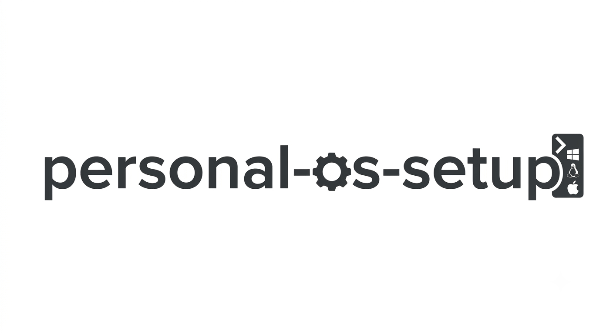
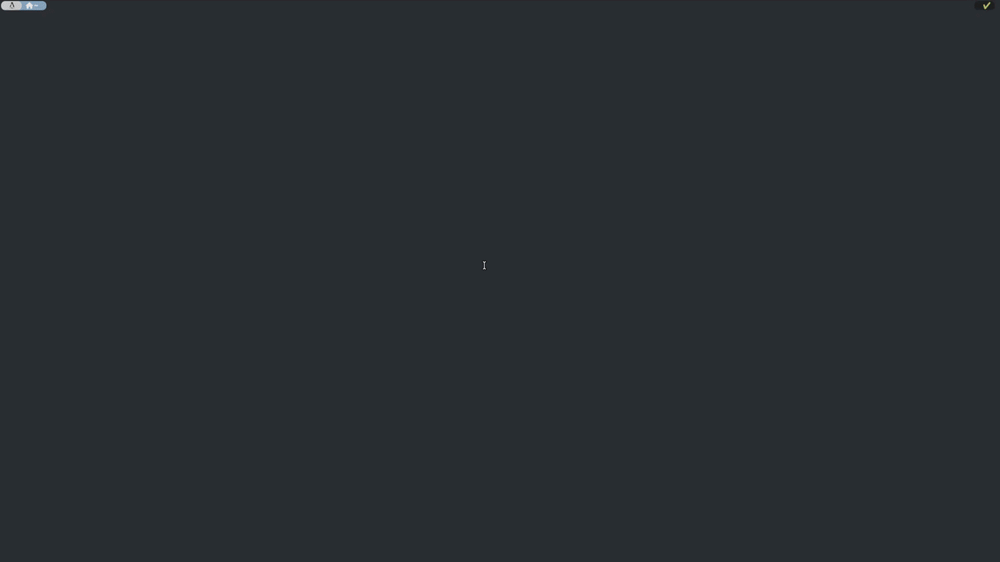

# Personal OS Setup


[](https://www.microsoft.com/en-in/windows)


[](https://github.com/AmineDjeghri/personal-os-setup/actions/workflows/ci.yml)
[](LICENSE)
[](http://personal-os-setup.aminedjeghri.com/)
[](https://github.com/AmineDjeghri/personal-os-setup)



| App Showcase                                            |
|---------------------------------------------------------|
|  |

A terminal app for installing packages and configuring Windows, Linux, macOS and WSL2,
with guides for desktops, home servers and Android TV.

## Get started

### Linux / WSL2 / macOS

```bash
sh -c "$(wget https://raw.githubusercontent.com/AmineDjeghri/personal-os-setup/main/install_unix.sh -O -)"
```

### Windows 11

Run PowerShell as administrator:

```powershell
$u='https://raw.githubusercontent.com/AmineDjeghri/personal-os-setup/main/install_windows.ps1'; $p="$env:TEMP\install_windows.ps1"; iwr $u -UseBasicParsing -OutFile $p; powershell -ExecutionPolicy Bypass -File $p
```

Then launch the app from any terminal:

```bash
personal-os-setup
```

Installation uses `~/.personal-os-setup` on Unix or `%USERPROFILE%\.personal-os-setup` on Windows.
Running the installer inside an existing clone updates that checkout instead.
The launcher pulls updates before starting the app. System changes require confirmation in the TUI.

## Develop

With Make, Bash, Git and uv available:

```bash
git clone https://github.com/AmineDjeghri/personal-os-setup.git
cd personal-os-setup
make install-dev
make pre-commit-install
make check
make run
```

`make check` runs static/docs checks, safe tests and isolated package installation.
CI also runs OS integration on disposable hosts. To link the launcher to your clone,
run `./install_unix.sh` or `./install_windows.ps1` from that clone.

| Task                         | Guide                                                                              |
|------------------------------|------------------------------------------------------------------------------------|
| Set up your editor and tools | [Setup](docs/developer/1.setup.md)                                                 |
| Find the relevant code       | [Project structure](docs/developer/2.project-structure.md)                         |
| Prepare a contribution       | [Contributing](CONTRIBUTING.md) and [conventions](docs/developer/3.conventions.md) |
| Run tests                    | [Testing](docs/developer/4.testing.md)                                             |
| Publish a release            | [Release](docs/developer/5.release.md)                                             |
| Try system changes in a VM   | [VM lab](docs/vm/README.md)                                                        |

Run `make help` for all targets. Agent instructions are in `AGENTS.md`; project skills are in
`.claude/skills/`.

## Platform guides

[Documentation site](http://personal-os-setup.aminedjeghri.com/) ·
[Linux](docs/linux/README.md) · [CachyOS](docs/linux/CachyOS.md) ·
[macOS](docs/macos_darwin/README.md) · [Windows and WSL](docs/windows_workflow/README.md) ·
[Home server](docs/home-server/readme.md) · [Android TV](docs/android-tv/readme.md).

[](https://star-history.dera.page/#AmineDjeghri/personal-os-setup)
