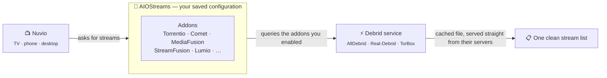

# 2 — Nuvio and Stremio + AIOStreams: quick start

This page takes you from nothing to a working streaming setup on **Nuvio** (everything below applies to **Stremio** as well): follow the steps and you are watching in about thirty minutes. The options you only need later are on the [advanced setup page](nuvio-stremio-aiostreams-advanced.md).

Table of contents
<!-- TOC -->
- [2 — Nuvio and Stremio + AIOStreams: quick start](#2-nuvio-and-stremio-aiostreams-quick-start)
    - [How the pieces fit together](#how-the-pieces-fit-together)
    - [Quick start steps](#quick-start-steps)
        - [Step 1 — What you need](#step-1-what-you-need)
        - [Step 2 — Create your Nuvio account](#step-2-create-your-nuvio-account)
        - [Step 3 — Subscribe to a debrid service](#step-3-subscribe-to-a-debrid-service)
        - [Step 4 — Load a ready-made configuration](#step-4-load-a-ready-made-configuration)
        - [Step 5 — Give it your debrid account](#step-5-give-it-your-debrid-account)
        - [Step 6 — Install the addon in Nuvio](#step-6-install-the-addon-in-nuvio)
        - [Step 7 — Test it](#step-7-test-it)
        - [Step 8 — If something doesn't work](#step-8-if-something-doesnt-work)
        - [💡 Nuvio and Stremio Tips](#nuvio-and-stremio-tips)
        - [📱 WEB and iOS](#web-and-ios)
    - [Next: advanced setup](#next-advanced-setup)
<!-- TOC -->

## How the pieces fit together

Four words are enough to follow the rest of this page:

- **Addon** — a source of streams or catalogs. Torrentio, Comet, MediaFusion, StreamFusion and Lumio are addons.
- **Debrid service** — the paid account that turns torrent sources into instant, high-speed playback (AllDebrid, Real-Debrid, TorBox…). You need one account, whatever you do next.
- **Configuration (config)** — the AIOStreams page where you pick your addons, filters, sorting and formatting. It is saved online and reached with a **UUID** plus a **password**.
- **Template** — a JSON file that fills a configuration. That is how this guide hands you a ready-made setup.

## Quick start steps

### Step 1 — What you need

- A **Nuvio** account (free).
- A **debrid** subscription (AllDebrid, Real-Debrid or TorBox). AllDebrid is what this guide is built around.
- The **configuration link** from step 4 of this page.
- A computer makes the website part more comfortable, but a phone is enough.

### Step 2 — Create your Nuvio account

1. Create your account on [nuvio.tv](https://nuvio.tv) and install the app: [Nuvio](https://nuvioapp.space/) is available on Android, Android TV and desktop, but not on iOS: see [WEB and iOS](#web-and-ios).
2. Log in with the same account on every device — **addons and settings sync between them**.
3. Do the rest of the setup on the website or on the app, whichever you prefer; the website has the better overview for accounts, profiles and integrations.

### Step 3 — Subscribe to a debrid service

A debrid service is an unrestricted multi-hoster: it fetches the torrent on its own servers and hands you the file at full speed, so your TV never downloads a torrent and you do not need a VPN. Most of the catalogue is already cached, which means instant playback.

1. Subscribe to [AllDebrid](https://alldebrid.com/) — **do not choose the free trial, it does not work for this**. Real-Debrid or TorBox work too.
2. Keep the account open in a browser tab: you will need to authorize your IP address later (step 7).
3. You only ever need **one** debrid account, whatever else you do later.

### Step 4 — Load a ready-made configuration

1. Open the AIOStreams page: 👉 [https://aiostreamsfortheweebs.midnightignite.me/](https://aiostreamsfortheweebs.midnightignite.me/) — you can also use [AIOStreams (ElfHosted)](https://aiostreams.elfhosted.com/), but it is limited to 10 addons and has no Torrentio support.
2. Go to the **Save & Install** page — 👉 [aiostreamsfortheweebs.midnightignite.me/stremio/configure?menu=save-install](https://aiostreamsfortheweebs.midnightignite.me/stremio/configure?menu=save-install) — click **Import → Import template** and paste one of these links:
    - (Recommended) **Amine's default config (essentials)** — nothing to fill in beyond your debrid service:
      `https://raw.githubusercontent.com/AmineDjeghri/personal-os-setup/main/docs/android-tv/aiostreams-template-essentials.json`
    - (Advanced) **Amine's default config (full)** — the same, plus custom addons (Lumio, StreamFusion, live sports, more catalogs…) that need a URL of your own (see [the advanced page](nuvio-stremio-aiostreams-advanced.md#36-custom-addons-you-can-plug-in-optional)):
      `https://raw.githubusercontent.com/AmineDjeghri/personal-os-setup/main/docs/android-tv/aiostreams-template-full.json`
3. Click **Use this template now**.
4. Click again on **Our Configuration → Browse ready-made setups**, choose the imported template and click **Use this setup**. The addons, filters, sorting and the stream formatter load automatically; AllDebrid is already wired into the stream addons.
5. Save the configuration: that is what creates your **UUID** and **password**. **Keep both** — they are your AIOStreams login and let you restore the whole setup on any device.

### Step 5 — Give it your debrid account

- If you subscribed to **AllDebrid**, there is nothing to do: the template already points the stream addons at it.
- If you use **Real-Debrid** or **TorBox**, enable your service in the **Services** section and switch each stream addon to it — it is one dropdown per addon.
- With the **full** template, the custom addons arrive **enabled with an empty URL**, and AIOStreams highlights those unfilled fields before you save. Fill the ones you want (their own sites are listed on the [advanced page](nuvio-stremio-aiostreams-advanced.md#36-custom-addons-you-can-plug-in-optional)) or switch them off in the **Addons** tab — if the save refuses an empty field, put anything in it and disable that addon in the **Addons** tab instead.
- If an addon gives you trouble, just disable it in the **Addons** tab and save again.

### Step 6 — Install the addon in Nuvio

1. Go to the **Save and Install** section.
2. Click **Save**. If you see a timeout error naming an addon, that addon is down at that moment — disable it and save again (StreamFusion, Lumio and OpenSubtitles V3+ are the usual suspects).
3. Click **Install**, then copy the manifest link.
4. Paste it in Nuvio: [nuvioapp.space/account?tab=addons](https://nuvioapp.space/account?tab=addons) (or through the app).
5. Nuvio shows what the addon provides, as a count of resources and catalogs (for example `5 resources / 45 catalogs`): a populated count means the addon was added properly.
6. If the link ever changes, the addon has to be reinstalled with the new one — editing the URL in place is not enough.

### Step 7 — Test it

Open any movie or series in Nuvio: you should see your addons providing streams — Statusio appears in the list only if you installed it — with the decorator emojis described in [Reading the stream list](nuvio-stremio-aiostreams-advanced.md#32-reading-the-stream-list).

The last thing to do is authorise your IP address on the debrid service: since the addons are hosted on different servers, your debrid account sees a new IP and blocks cached access until you confirm it. Start any stream, go to your debrid account page, accept the prompt — cached streams switch from ⏳ to ⚡️.

### Step 8 — If something doesn't work

- **Every stream shows ⏳ and none ⚡️** — your debrid account has not validated your IP yet: start a stream, then accept the prompt on the debrid website.
- **A timeout error naming an addon when you save** — that addon is down; disable it and save again.
- **The addon does not appear in Nuvio** — the manifest link was not accepted: copy it again from *Save and Install* and re-add it.
- **You lost your UUID or password** — they belong to your AIOStreams account; recover them from there rather than starting over, otherwise your configuration is orphaned.

### 💡 Nuvio and Stremio Tips

- In Stremio/Nuvio Settings, you can select the preferred 'Audio language' and 'Subtitles'. This will automatically set the audio and subs automatically when you watch something. This is not synced between devices, you need to do it manually on each of your device.
- All settings & addons will sync between your devices if you use the same account.
- After making any change to AIOStreams or other addons, you don't need to close the application to synchronize the changes, you can switch between profiles to reload the items.

- **(Optional) Trakt**:
    - Trakt is a media tracking service that helps users sync their TV shows and movies across numerous platforms and devices.
    - You can enable trakt in Nuvio/Stremio settings. You can download Trakt mobile app or use their website.
    - A metadata addon (Cinemeta with the essentials template, AIOMetadata with the full one) is required to sync Trakt properly.
    - Ratings & history: rate your movies (and series) on Trakt (they are marked as watched automatically if you activate that setting on Trakt's website: Settings → Mark Watched After Rating → Automatically mark unwatched items with today's date).
    - If you didn't rate some movies & tv shows, you can add them to history in Trakt to avoid being recommended by the 'AI Search' addon.
    - If you want to synchronize Trakt with IMDB you can use [IMDB-Trakt-Syncer](https://github.com/RileyXX/IMDB-Trakt-Syncer). You can rate what you watch on IMDB or trakt and run the python app to sync everything.
    - You can also import Netflix and Amazon Prime Video watch history to Trakt using this free opensource Chrome/Firefox extension : <https://github.com/trakt-tools/universal-trakt-scrobbler>

### 📱 WEB and iOS

AIOStreams also has its own app, a good alternative client for every screen: in a browser ([web.aiostreams.org](https://web.aiostreams.org) and select <https://aiostreamsfortheweebs.midnightignite.me/> as a server), on Android and Android TV, on computers and on LG and Samsung TVs. It shows the catalogs and streams of your configuration, plus Live TV. Get it from [aiostreams.org/download](https://aiostreams.org/download) or read the [app documentation](https://aiostreams.org/apps).

Nuvio is not available on **iOS**, so use the web app there:

1. Open the AIOStreams web app in Safari and sign in to your configuration.
2. Share → **Add to Home Screen** to install it as a PWA.
3. Use **VLC** as the external player for streams the browser cannot play.

## Next: advanced setup

Parent and child configurations, variants, extra addons (live sports, Lumio, StreamFusion), custom posters, the proxy and Nuvio profiles are on the [advanced setup page](nuvio-stremio-aiostreams-advanced.md).
