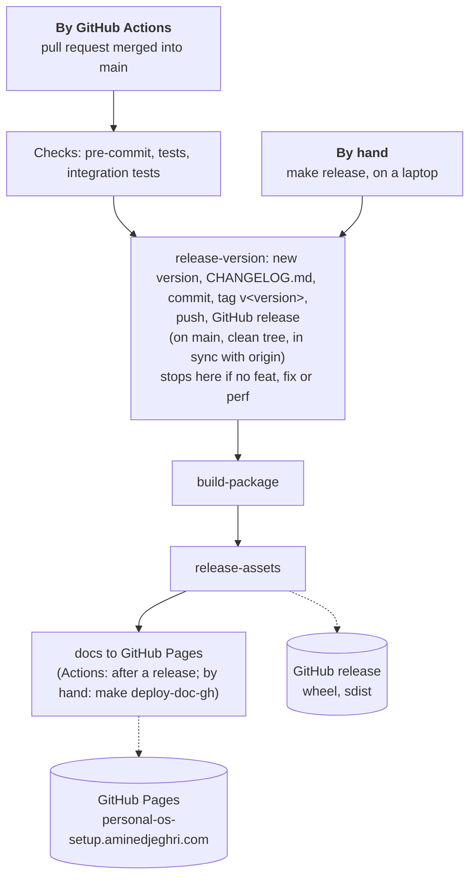
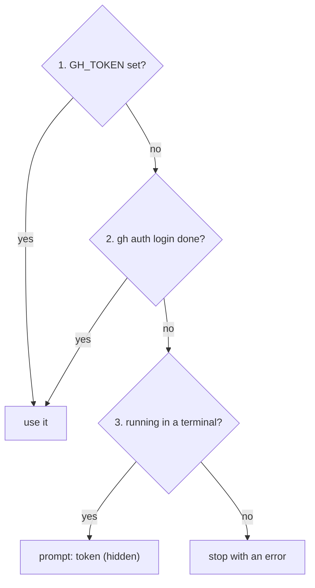

# 5. Release

Publish a version: by hand from a laptop, or by GitHub Actions after a merge. Both run the same
`make` targets (`makefiles/release.mk`, logic in `scripts/release.sh`).

## Overview



## What a release publishes

| What                                                      | Where                                     | By hand                             | By GitHub Actions       |
|-----------------------------------------------------------|-------------------------------------------|-------------------------------------|-------------------------|
| version, `CHANGELOG.md`, tag `v<version>`, GitHub release | this repository                           | `make release-version`              | after a merge to `main` |
| wheel + sdist on the GitHub release                       | GitHub Releases                           | `make build-package release-assets` | after a release         |
| documentation site                                        | GitHub Pages (`gh-pages` branch, `CNAME`) | `make deploy-doc-gh`                | after a release         |

The version comes from the commit messages since the last tag
([3. Conventions](3.conventions.md#commit-convention)): no `feat`/`fix`/`perf`, no release. A
`v<x.y.z>-rc.<n>` release candidate is only made from a `dev` branch (retired, see
`dev-release.yml`).

## By hand

```bash
make release          # release-version, then build-package and release-assets
make deploy-doc-gh    # then the documentation site (force-pushes gh-pages): not part of make release
```

Once a release is out, leave the next ones to GitHub Actions so each one comes from a merged pull
request.

### Guards

`make release-version` refuses to start, and changes nothing, when:

| Check                                                        | Message                                               |
|--------------------------------------------------------------|-------------------------------------------------------|
| the branch is not `main` (or `dev`)                          | `release from main or dev only`                       |
| the tree has uncommitted changes                             | `uncommitted changes: commit or stash them first`     |
| `HEAD` differs from `origin/<branch>` after a fetch          | `<branch> is not in sync with origin/<branch>`        |
| no GitHub token can be found                                 | `no GitHub token: set GH_TOKEN or run: gh auth login` |
| no `feat`/`fix`/`perf` since the last tag, or the tag exists | nothing to release (not an error)                     |

`make release` only builds and uploads when `HEAD` carries the new tag. The release commit runs
without the git hooks (only for that commit), so pre-commit cannot block or rewrite it. It is
authored by you (`git config user.name/email`); in CI, by the bot.

### Credentials

The GitHub token is looked for in this order:

| Order | Method              | Setup                  |
|-------|---------------------|------------------------|
| 1     | `GH_TOKEN` variable | your shell or `.env`   |
| 2     | the `gh` login      | once: `gh auth login`  |
| 3     | hidden prompt       | nothing; terminal only |



The token is never printed; it only travels through the environment. GitHub Actions passes the
automatic `GITHUB_TOKEN`, so step 1 always succeeds there.

## By GitHub Actions

| Workflow                                 | Trigger                                          | Does                                                                                |
|------------------------------------------|--------------------------------------------------|-------------------------------------------------------------------------------------|
| `🔍 PR — Quality Checks` (`ci.yml`)      | pull request                                     | PR title, pre-commit, tests                                                         |
| `🚀 Release — Main` (`main-release.yml`) | push to `main` (a merged pull request is a push) | checks, `make release-version`, `make build-package`, `make release-assets`, docs   |
| `🔶 Release — Dev` (`dev-release.yml`)   | push to `dev`                                    | the same, as a release candidate (prerelease)                                       |
| Renovate                                 | schedule                                         | dependency pull requests ([3. Conventions](3.conventions.md#dependencies-renovate)) |

The release commit message ends with `[skip ci]`, so it does not start another release.

## Repository settings (once)

- Settings → Actions → General → Workflow permissions: "Read and write permissions".
- Pages: "Deploy from a branch: `gh-pages`". The branch is created by the first
  `make deploy-doc-gh`. If GitHub refuses to deploy from the branch, see
  [this discussion](https://github.com/orgs/community/discussions/39054).
- Never create a tag by hand: semantic-release computes the next version from the last tag.
