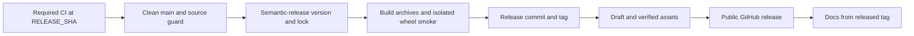

# 5. Release

Publish artifacts from a tested main revision, then deploy documentation from the released tag.

## Release order

1. Required CI validates its event revision on the hosted platform matrix.
2. `make release` requires clean `main`, synchronization with origin and `RELEASE_SHA` identifying
   that tested revision. A newer untested branch tip is rejected.
3. Semantic-release chooses the version, updates the changelog/lock, builds the wheel and sdist,
   and runs the isolated installation smoke before committing, tagging and pushing.
   It does not create a public GitHub release.
4. `make release-assets` checks the clean checkout against its local and remote tag, validates
   both archives and the installed wheel, creates a draft when needed, and uploads missing assets.
   Existing assets must match byte for byte; differing assets stop publication and are never overwritten.
5. The complete remote artifact pair is downloaded and compared before the draft becomes public.
6. CI checks out `v<version>` to run `make deploy-doc-gh`, so site version/changelog content matches the release.



## Manual release and recovery

1. Check that the chosen main revision passed required CI. Install development dependencies once.
2. Run the shared target deliberately (agents need explicit per-action approval):

    ```bash
    RELEASE_SHA=<tested-commit-sha> make release
    ```

3. If interrupted after the release commit/tag was pushed, rerun with the same `RELEASE_SHA`.
   The guard accepts only that commit or its exact tagged semantic-release child: only project
   version, root lock version and changelog may change. Untested source/configuration/dependency
   changes are rejected. Existing tags resume publication instead of reporting no release.
4. To use an already built complete pair from a clean tagged checkout, run `make release-assets`.
   It smoke-checks those exact artifacts without rebuilding them. A failed upload leaves the
   draft recoverable; matching existing assets are retained.
5. Retry failed docs jobs separately, or deploy manually from the clean released tag with
   `make deploy-doc-gh`. That command pushes `gh-pages` and requires explicit approval.

`make release-version` performs the version/build/smoke/tag stage only. It does not publish
artifacts. A semantic-release preview error fails; no releasable commits is a successful no-op.
Hatch builds reproducibly, and prerelease filenames follow PEP 440 while tag spelling is preserved.
Never edit `project.version` or create release tags by hand.

## Credentials

| Order   | Source                            |
|---------|-----------------------------------|
| 1       | `GH_TOKEN` in the environment     |
| 2       | existing `gh auth login` session  |
| 3       | hidden prompt, terminals only     |

Tokens are never printed. CI supplies `GITHUB_TOKEN` through `GH_TOKEN`.

## Workflows and repository setup

| Workflow                 | Trigger                      | Purpose                                   |
|--------------------------|------------------------------|-------------------------------------------|
| `ci.yml`                 | branch pushes and PRs        | title, static/docs and platform checks    |
| `main-release.yml`       | main push or manual on main  | required checks, release/recovery, docs   |

The `dev` branch and release workflow are retired. Release commits use `[skip ci]` to prevent a loop.
Summary output distinguishes no releasable commits, failed/skipped validation and incomplete publication.

1. Enable Actions write permission for release publication.
2. Configure Pages to deploy from `gh-pages`; the first approved deployment creates it.
3. Keep release commits and tags under semantic-release ownership.
