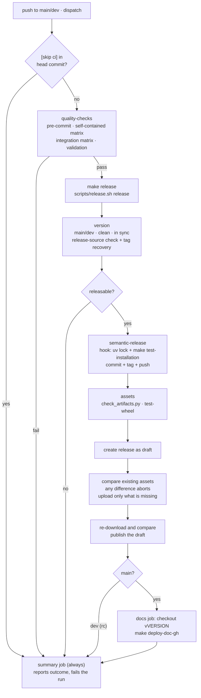

# 5. Release

Publish the package to a GitHub Release (one wheel and one sdist, never a package index) and the
documentation to GitHub Pages.

## Contents

- [Before you start](#before-you-start)
- [What a release does](#what-a-release-does)
- [Automatic release (CI)](#automatic-release-ci)
- [Manual release (local)](#manual-release-local)
- [Recover an interrupted release](#recover-an-interrupted-release)
- [Verify the release](#verify-the-release)
- [Fix a bad release](#fix-a-bad-release)
- [After a release: sync main into dev](#after-a-release-sync-main-into-dev)

## Before you start

Once, in the repository settings:

- Actions → General → Workflow permissions: **Read and write**. The workflow declares `permissions: {}`
  and grants `contents: read` to the checks, `contents: write` to the release and docs jobs.
- Pages → Deploy from a branch → `gh-pages`.
- Squash merging enabled, so the PR title decides the version
  ([commit convention](3.conventions.md#commit-convention)).

Locally, install the tooling and log in:

```bash
make install-dev
gh auth login
```

Credentials resolve from `GH_TOKEN` (environment), then the token saved by `gh auth login`, then a
hidden terminal prompt; `release-assets` uses the token or gh login, and CI supplies its automatic
token. Never print credentials.

## What a release does

1. **Validate** the source: `main` or `dev`, clean tree, HEAD equal to the fetched origin tip, and the
   release source (`GITHUB_SHA` in CI, `HEAD` locally) accepted by `scripts/check_release_source.py`.
2. **Version** with semantic-release from Conventional Commits. Its build hook refreshes the lock and
   installs the built wheel before anything is committed, tagged or published.
3. **Commit, tag and push** `chore(release): v<version> [skip ci]`.
4. **Upload** the wheel and sdist to a GitHub Release: created as a draft, every existing asset
   compared, only the missing files uploaded, then published after a second comparison.
5. **Deploy docs** from the release tag, on a stable `main` release only.

Never edit a version, the changelog or a tag by hand. The wheel and sdist versions equal
`project.version`; tags keep `vX.Y.Z-rc.N` spelling, Python artifact names use `X.Y.ZrcN`.



## Automatic release (CI)

`main-release.yml` runs on every push to `main` or `dev`, and on manual dispatch (dispatch always runs
the checks):

| Branch | Result                                             |
|--------|----------------------------------------------------|
| `dev`  | release candidate `vX.Y.Z-rc.N`, marked prerelease |
| `main` | stable `vX.Y.Z`, and docs deployed from that tag   |

`quality-checks` is the gate (pre-commit, a self-contained test matrix, an integration matrix and a
required-validation job); if it fails or is skipped, nothing is versioned or published. The release job
then runs `make release`, and a final `summary` job reports the combined outcome and fails the run when
publication is incomplete.

The release commit carries `[skip ci]`, so its own push does not re-run the gate. A retry accepts that
exact single-parent `chore(release)` child of the tested source, including recovery before its tag was
pushed, and rejects any newer application change. Docs-only commits bump no version, so they publish
nothing.

## Manual release (local)

Use a clean `main` (stable) or `dev` (candidate), synchronized with origin. Complete
[setup](1.setup.md) and [Before you start](#before-you-start), then run:

```bash
make check
make release
```

The release command versions, builds and uploads the wheel/sdist pair. It changes Git and GitHub;
coding agents need explicit per-action approval. Locally, the source revision is `HEAD`; GitHub Actions
supplies its tested `GITHUB_SHA` automatically. Confirm required CI passed before publishing manually;
`make check` alone does not establish hosted integration success.

`make release-status` reports branch, tree, origin sync, tag and GitHub release state without changing
anything. Run it first when a release refuses.

### If the guard refuses

- **Dirty tree** from hook fixes or a stale lock: commit it before releasing, as `chore(...)` or by
  amending the pending commit. A `fix:`/`feat:` fix-up commit becomes part of the release and bumps the
  version.
- **Not in sync with origin:** `git pull --rebase` when behind, `git push` when ahead. The release does
  not push your work for you.
- **Wrong branch:** release from `main` (stable) or `dev` (candidate) only.

For a stable manual release, publish docs separately from the clean released tag:

```bash
make deploy-doc-gh
```

That command pushes `gh-pages` and requires separate authorization.

## Recover an interrupted release

`make release` runs `version` then `assets`; each stage is re-runnable and stops before publishing on a
bad precondition:

- `version` requires `main`/`dev`, a clean tree, HEAD equal to origin, and a release source accepted
  by `scripts/check_release_source.py`.
- The semantic-release build hook runs `uv lock`, stages the lock and runs `make test-installation`; a
  failure stops the run before any commit, tag or publication.
- `assets` requires the tag at HEAD locally and on the remote, the wheel/sdist pair, and existing
  assets byte-identical to the local files.

Pick the smallest retry that matches the state:

- **CI:** rerun the failed job while its tested source still matches the release; a missing tag is
  recreated from the verified release commit.
- **Same branch, locally:** `make release` stops without uploading when nothing is left to publish.
- **From a clean checkout of the exact tag:** `make build-package`, then `make release-assets`.
- **Newer application commits exist:** let their own workflow release them. Never rebuild an older
  release from later source.
- A release left as a draft is published by the next `make release`; `release-assets` never replaces a
  published file and does not publish to a package index.

## Verify the release

`gh release view vX.Y.Z --json assets,isDraft` shows one wheel, one sdist and `isDraft: false`; the tag
resolves to the `chore(release): vX.Y.Z [skip ci]` commit. A stable release also adds a `gh-pages`
commit.

## Fix a bad release

- Fix forward: revert on `main` and let the next patch release carry the fix.
- Do not move, delete or re-create a published tag: the asset stage requires the tag to point at the
  checkout being published, and artifact names derive from the version.
- Treat an upload as final: a published file that differs from the local artifact aborts the release
  instead of overwriting it.

## After a release: sync main into dev

Merge `main` back into `dev` after a stable release. Use the stable version and changelog as the base
for the next candidate; see [branch conventions](3.conventions.md#branches-and-pull-requests).
